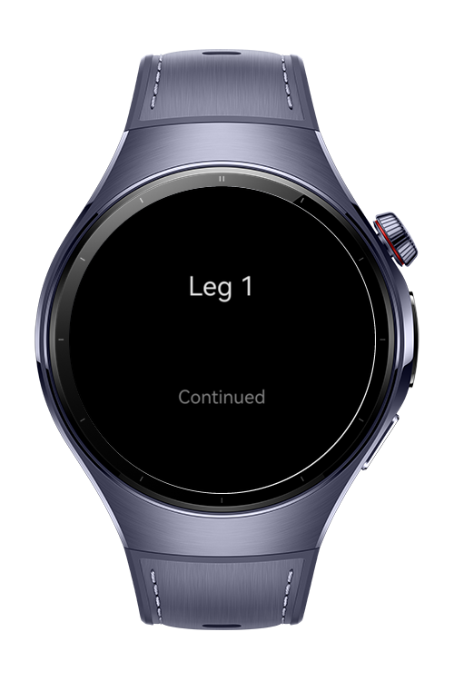

> **Note:** To access all shared projects, get information about environment setup, and view other guides, please visit [Explore-In-HMOS Index](https://github.com/Explore-In-HMOS/hmos-index).

# How To Build Cross Device Continuation

A wearable ArkTS Codelab where route guidance running on the watch is migrated to a nearby phone. Using continueManager,
the watch acts as the migration target and, thanks to quick start, renders immediately while the route state is still
arriving. The codelab covers the receiving side of cross-device migration: registering for the quick-start result,
restoring handed-off state, and reporting the outcome.

# Preview

<div>
    
    
</div>

# Use Cases

- **Quick-start launch**: the target app renders a loading dial instantly instead of waiting for migration data.
- **Result observation**: `continueManager.on('prepareContinue')` reports when the handed-off data has arrived.
- **State restore**: the migrated route leg is unpacked from `want.parameters` and shown on the dial.
- **Lifecycle cleanup**: the callback is unregistered on `aboutToDisappear` via `continueManager.off`.
- **Source handoff**: `onContinue` packs the live route state and agrees to migrate.

# Tech Stack

- **Languages**: ArkTS, ArkUI
- **Frameworks**: HarmonyOS SDK 6.0.1(21)
- **Tools**: DevEco Studio Version 6.1.1
- **Libraries & Kits**:
    - `@kit.AbilityKit`
    - `@kit.ArkUI`
    - `@kit.PerformanceAnalysisKit`

# Directory Structure

```
entry/src/main/ets/
|---pages
|   |---Index.ets
|---module.json5
```

# Constraints and Restrictions

## Supported Devices

- Huawei Watch 5

# License

**How To Build Cross Device Continuation** is distributed under the terms of the MIT License
See the [license](./LICENSE) for more information.
